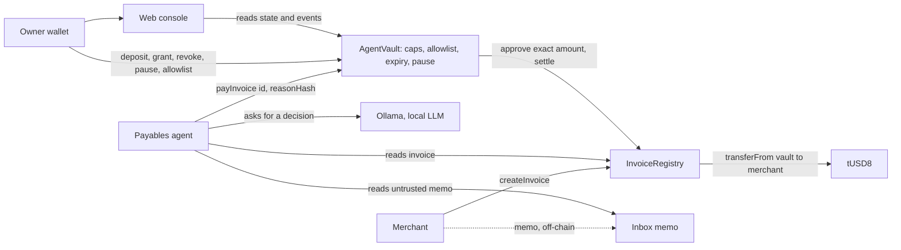

# LeashPay

Spend-capped, revocable tUSD8 payment vaults for AI agents on Aevum (QDay post-quantum testnet).

An owner funds a vault and gives an AI agent a narrow session key: a per-payment cap, a daily cap, an expiry date and a list of payees it may pay. The agent reads invoices, reasons about them with a local open-source LLM (Ollama, no paid API), and pays through the vault. The limits are enforced by the contract, not by the model, so a prompt-injected or fully compromised agent still cannot move money outside its leash. The owner can pause or revoke instantly, and every action leaves an on-chain audit trail.

Built for Aevum Builder Challenge #1. Everything runs on the Aevum testnet with test tokens only.

## Live on Aevum testnet (chain 44005)

| | Address |
|---|---|
| AgentVault | [`0x81faaad38c95ef074f5df51a07c3d875a4540bf2`](https://explorer-test.qday.info/address/0x81faaad38c95ef074f5df51a07c3d875a4540bf2) |
| InvoiceRegistry | [`0x25c255b8f752a081c454080e85ba0595ee5b11ca`](https://explorer-test.qday.info/address/0x25c255b8f752a081c454080e85ba0595ee5b11ca) |
| tUSD8 (platform token) | [`0x456569838f1d43009A91ebA4263147Afd7233483`](https://explorer-test.qday.info/address/0x456569838f1d43009A91ebA4263147Afd7233483) |
| Owner | [`0x90b2a4400f8164b2Eb486421827046EAB568f531`](https://explorer-test.qday.info/address/0x90b2a4400f8164b2Eb486421827046EAB568f531) |
| Agent | [`0x554cb6f22B0A90EBeEEbfe419cde47cd0754f13A`](https://explorer-test.qday.info/address/0x554cb6f22B0A90EBeEEbfe419cde47cd0754f13A) |
| Merchant | [`0x175d9B9e0f6c6d26a5cAc2983A6956acB99E9732`](https://explorer-test.qday.info/address/0x175d9B9e0f6c6d26a5cAc2983A6956acB99E9732) |

Transaction evidence, including the blocked attack, is listed in [docs/EVIDENCE.md](docs/EVIDENCE.md). The explorer's contract verifier is not working yet, so the verified source is this repository.

## The problem

Giving an AI agent a wallet is dangerous. An agent that reads untrusted text (invoices, emails, web pages) can be talked into paying the wrong person, and a leaked agent key drains whatever it can reach. Telling the model to be careful is not a control.

## What LeashPay does

1. The merchant creates an invoice on-chain. Any memo text lives off-chain and is treated as untrusted.
2. The agent reviews the invoice with a local LLM and runs the same checks the contract will run.
3. The agent calls `payInvoice` on the vault. The vault checks, in code: not paused, agent active and not expired, invoice open and not expired, payee on the allowlist, amount within the per-payment cap, running total within the daily cap.
4. Only then does the vault pay the exact invoice amount, once. Each payment records a hash of the agent's reasoning.
5. The owner watches the allowance in the web console and can pause or revoke in one transaction.

If the LLM is fooled, the contract still says no. The demos below prove it on-chain.

## Architecture



More detail in [docs/ARCHITECTURE.md](docs/ARCHITECTURE.md). The threat model is in [docs/THREAT_MODEL.md](docs/THREAT_MODEL.md).

## Repository layout

```
contracts/   Foundry project: AgentVault, InvoiceRegistry, tests, deploy script
sdk/         TypeScript client (viem): reads, writes, revert explanations, audit trail
agent/       Ollama payables agent and CLI
web/         Owner console (Vite, React, viem)
scripts/     Setup, demo and audit scripts for the live testnet
docs/        Architecture, threat model, SDK guide, demo script, evidence
```

## Reproduce it

Requirements: Node 20 or newer, [Foundry](https://book.getfoundry.sh/getting-started/installation), [Ollama](https://ollama.com), a browser wallet (MetaMask or Rabby) for the web console. Everything is free.

```
git clone --recursive https://github.com/KaparthyReddy/leashpay.git
cd leashpay
npm install
cd contracts && forge install foundry-rs/forge-std openzeppelin/openzeppelin-contracts@v5.0.2 && forge test && cd ..
ollama pull llama3.2:3b
```

Create three throwaway wallets and an env file (private keys stay in `.env`, which is gitignored):

```
cp .env.example .env
for role in DEPLOYER AGENT MERCHANT; do
  key=$(cast wallet new --json | python3 -c "import sys,json; print(json.load(sys.stdin)['data'][0]['private_key'])")
  sed -i.bak "s|^${role}_PRIVATE_KEY=.*|${role}_PRIVATE_KEY=${key}|" .env
  echo "${role}: $(cast wallet address --private-key $key)"
done
rm -f .env.bak
```

Fund the deployer from the Discord `/faucet` command (1 tQDAY and 5 tUSD8), then send 0.1 tQDAY each to the agent and merchant addresses:

```
set -a; source .env; set +a
cast send $(cast wallet address --private-key $AGENT_PRIVATE_KEY) --value 0.1ether --private-key $DEPLOYER_PRIVATE_KEY --rpc-url $AEVUM_RPC_URL --legacy
cast send $(cast wallet address --private-key $MERCHANT_PRIVATE_KEY) --value 0.1ether --private-key $DEPLOYER_PRIVATE_KEY --rpc-url $AEVUM_RPC_URL --legacy
```

Deploy to Aevum testnet and record the addresses in `.env`:

```
cd contracts
forge script script/Deploy.s.sol --rpc-url https://rpc-test.qday.info --broadcast --legacy
cd ..
python3 - <<'PY'
import json,re
d=json.load(open("contracts/broadcast/Deploy.s.sol/44005/run-latest.json"))
a={t["contractName"]:t["contractAddress"] for t in d["transactions"] if t.get("contractName")}
s=open(".env").read()
s=re.sub(r"^INVOICE_REGISTRY_ADDRESS=.*$","INVOICE_REGISTRY_ADDRESS="+a["InvoiceRegistry"],s,flags=re.M)
s=re.sub(r"^AGENT_VAULT_ADDRESS=.*$","AGENT_VAULT_ADDRESS="+a["AgentVault"],s,flags=re.M)
open(".env","w").write(s)
PY
```

Run the flow:

```
npx tsx scripts/setup.ts
npx tsx agent/src/cli.ts status
npx tsx scripts/demo-pay.ts
npx tsx scripts/demo-attack.ts
npx tsx scripts/demo-controls.ts
npx tsx scripts/audit.ts
```

Run the web console (put the vault, registry and agent addresses in `web/.env`, see the table below):

```
npm run dev -w web
```

## Environment variables

Root `.env`:

| Variable | Required | Meaning |
|---|---|---|
| `AEVUM_RPC_URL` | no | Defaults to `https://rpc-test.qday.info` |
| `AEVUM_CHAIN_ID` | no | Defaults to `44005` |
| `AEVUM_EXPLORER_URL` | no | Defaults to `https://explorer-test.qday.info` |
| `TUSD8_ADDRESS` | no | Defaults to the official tUSD8 address |
| `DEPLOYER_PRIVATE_KEY` | yes | Owner wallet (throwaway testnet key) |
| `AGENT_PRIVATE_KEY` | yes | The agent's session key |
| `MERCHANT_PRIVATE_KEY` | yes | The invoicing merchant |
| `INVOICE_REGISTRY_ADDRESS` | yes | Set by the deploy step |
| `AGENT_VAULT_ADDRESS` | yes | Set by the deploy step |
| `OLLAMA_HOST` | no | Defaults to `http://127.0.0.1:11434` |
| `OLLAMA_MODEL` | no | Defaults to `llama3.2:3b` |
| `INBOX_DIR` | no | Where invoice memos are read from, defaults to `inbox` |
| `DEPLOY_BLOCK` | no | Start block for the audit trail; read from the deploy record if unset |

`web/.env`: `VITE_VAULT_ADDRESS`, `VITE_REGISTRY_ADDRESS`, `VITE_AGENT_ADDRESS`, `VITE_DEPLOY_BLOCK`, plus optional `VITE_RPC_URL`, `VITE_CHAIN_ID`, `VITE_EXPLORER_URL`, `VITE_TOKEN_ADDRESS`.

## Aevum integration

| Platform feature | How LeashPay uses it |
|---|---|
| tUSD8 | The only payment asset. Invoices and vault balances are denominated in tUSD8 (6 decimals). |
| Shanghai EVM | `foundry.toml` pins `evm_version = "shanghai"`, no Cancun opcodes. |
| Legacy transactions | The SDK and web console send type 0 transactions. |
| 1,000-block log limit | The audit reader splits `eth_getLogs` into chunks of at most 1,000 blocks. |
| Gas in tQDAY | Owner, agent and merchant each hold a small tQDAY balance for gas. |

Session keys, spending limits, expiry, scoped permissions and revocation are implemented in the vault contract itself, as the Aevum kit recommends (no account abstraction needed). See the SDK guide in [docs/SDK.md](docs/SDK.md).

## Known constraints

- Testnet only. tUSD8 here has no value.
- Source verification on the explorer is unavailable at the moment; verify against this repository's commit.
- ERC-8004 agent identity is on the roadmap, not implemented.
- Blocked payments revert on-chain, so they appear as failed transactions on the vault's explorer page, not in the event log.
- The daily window is anchored to the time of the grant and resets lazily on the first payment after 24 hours.
- The 3-billion-parameter local model can be wrong. That is the point: it is advisory, and the contract is the control.
- The owner is a single key. A multisig owner is recommended for anything beyond a demo.

## Roadmap

- ERC-8004 identity and reputation for agents.
- Per-payee caps and category budgets.
- Gasless agent payments with signed intents and a relayer.
- Multisig owner and timelocked policy changes.
- Event indexer and hosted dashboard.
- Mainnet deployment with the Aevum builder program.

## Tests

```
cd contracts && forge test -vv
npm test
npm run typecheck
```

The contracts have 20 tests, including a fuzz test on the per-payment cap. The SDK and agent have 18 unit tests.

## License

MIT. See [LICENSE](LICENSE) and [NOTICE.md](NOTICE.md).
