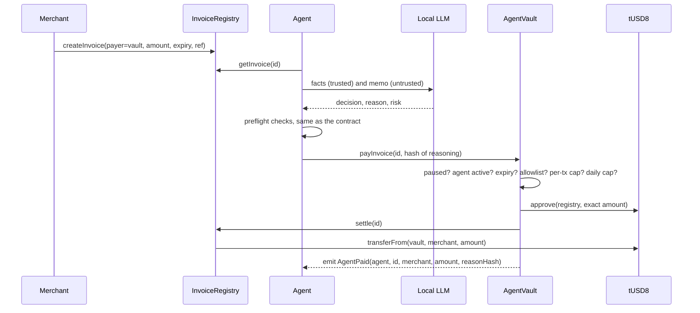

# Architecture

## Components

| Component | Role |
|---|---|
| `InvoiceRegistry` | Stores invoices (merchant, optional restricted payer, amount, expiry, status, reference hash). `settle` pulls tUSD8 from the caller to the merchant and marks the invoice paid, once. |
| `AgentVault` | Holds the owner's tUSD8. Grants agents narrow policies and pays invoices on their behalf only within those policies. |
| Payables agent | Off-chain process. Reads invoices, asks a local LLM for a decision, mirrors the contract checks, then submits `payInvoice`. |
| SDK | Typed viem client, plain-language revert messages, chunked audit reader. |
| Web console | Read-only dashboard for anyone, owner controls for the connected owner wallet. |

## Payment flow

## Vault checks, in order

1. The vault is not paused.
2. The caller has an active policy and it has not expired.
3. The invoice is open (not paid, cancelled, or unknown).
4. The invoice's merchant is on the allowlist.
5. The amount is at most the per-payment cap.
6. The amount plus spend in the current 24 hour window is at most the daily cap.
7. The invoice itself is not expired and its optional payer restriction matches the vault (checked by the registry).

Any failure reverts with a specific custom error, which the SDK turns into a plain sentence.

## Why the checks live in the contract

The agent runs a local model that reads untrusted text, so it is an advisory layer. The vault is the control: it does not read memos, it only reads invoice fields and its own policy. The agent can be wrong, prompt-injected or fully compromised, and the worst case is bounded by the owner's caps, allowlist and expiry.

## Safety properties

- Least privilege: an agent can only call `payInvoice`, only for allowlisted payees, only up to its caps.
- Spend caps: per payment and per rolling day, enforced on-chain.
- Expiry: policies end at a set time without any action.
- Instant revocation: `revokeAgent` and `setPaused` take effect in the next block.
- No lingering approvals: the vault approves the registry for the exact invoice amount, which `settle` consumes in the same transaction.
- No double payment: an invoice moves from open to paid exactly once.
- Audit trail: `Deposited`, `Withdrawn`, `PayeeSet`, `AgentGranted`, `AgentRevoked`, `PausedSet` and `AgentPaid` events, with a hash of the agent's reasoning on every payment.
- Contract hygiene: OpenZeppelin `Ownable2Step`, `ReentrancyGuard`, `SafeERC20`, custom errors, Shanghai-safe bytecode.

## Contracts

### InvoiceRegistry

- `createInvoice(payer, amount, expiresAt, ref)` returns the new id. `payer = 0` means anyone may pay.
- `cancelInvoice(id)` for the merchant while the invoice is open.
- `settle(id)` for the payer; transfers tUSD8 from the caller to the merchant.
- `getInvoice(id)` returns the struct.

### AgentVault

- Owner: `deposit` (anyone), `withdraw`, `setPayee`, `grantAgent(agent, expiresAt, perTxCap, dailyCap)`, `revokeAgent`, `setPaused`.
- Agent: `payInvoice(invoiceId, reasonHash)`.
- Views: `getPolicy`, `remainingToday`, `balance`, `payeeAllowed`, `paused`.

## Off-chain flow in the agent

1. Load the on-chain invoice and the policy.
2. Load the memo from the inbox (untrusted text).
3. Ask the model for `{decision, reason, risk}`. Output that is not valid JSON counts as a rejection.
4. Run the preflight (the same rules as the vault).
5. If the model says pay and preflight passes, submit the payment with `keccak256` of the decision as the reason hash.
6. If the model says reject, do nothing.
